# Процедуры и автоматы L2/L3

Сгенерировано `python -m decision.fsm --diagrams` из `reference/scenarios.yaml` и `decision/fsm.py`.

## Обслуживание клиента — приём или выдача наличных (`client_service`)

Обязательные шаги: 1_person_enter_client.

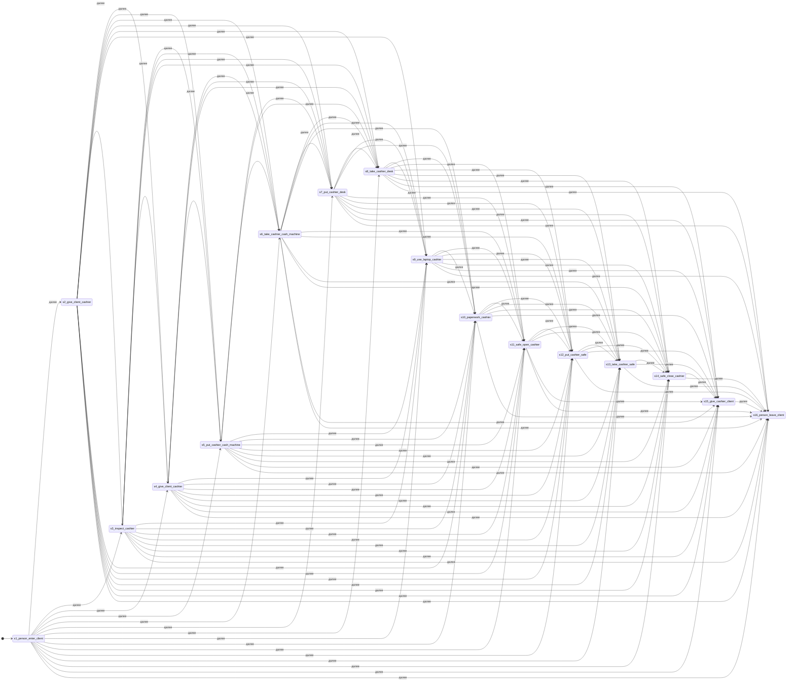

## Инкассация — передача и вскрытие сумок (`collection`)

Обязательные шаги: .

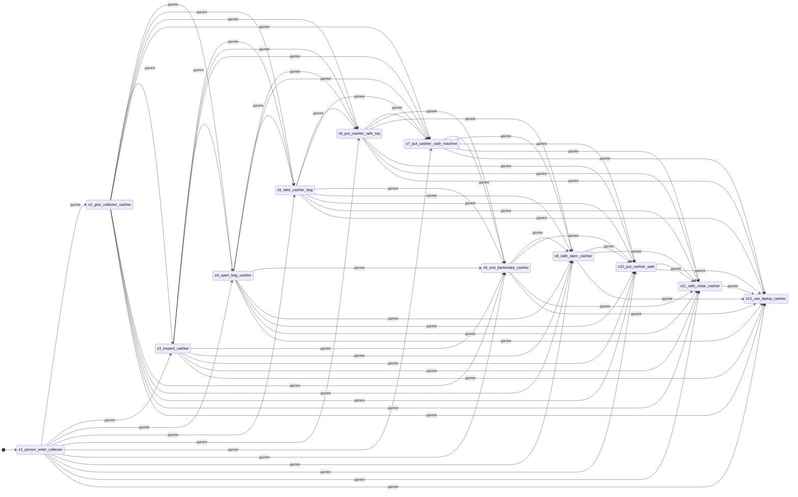

## Работа с наличностью без посетителей (`cash_handling`)

Обязательные шаги: 5_put_cashier_cash_machine.

```mermaid
stateDiagram-v2
  direction LR
  state "s1_person_enter_cashier" as s1_person_enter_cashier
  state "s2_safe_open_cashier" as s2_safe_open_cashier
  state "s3_take_cashier_safe" as s3_take_cashier_safe
  state "s4_safe_close_cashier" as s4_safe_close_cashier
  state "s5_put_cashier_cash_machine" as s5_put_cashier_cash_machine
  state "s6_sort_banknotes_cashier" as s6_sort_banknotes_cashier
  state "s7_paperwork_cashier" as s7_paperwork_cashier
  state "s8_use_laptop_cashier" as s8_use_laptop_cashier
  s1_person_enter_cashier --> s2_safe_open_cashier: далее
  s1_person_enter_cashier --> s3_take_cashier_safe: далее
  s1_person_enter_cashier --> s4_safe_close_cashier: далее
  s1_person_enter_cashier --> s5_put_cashier_cash_machine: далее
  s2_safe_open_cashier --> s3_take_cashier_safe: далее
  s2_safe_open_cashier --> s4_safe_close_cashier: далее
  s2_safe_open_cashier --> s5_put_cashier_cash_machine: далее
  s3_take_cashier_safe --> s4_safe_close_cashier: далее
  s3_take_cashier_safe --> s5_put_cashier_cash_machine: далее
  s4_safe_close_cashier --> s5_put_cashier_cash_machine: далее
  s5_put_cashier_cash_machine --> s6_sort_banknotes_cashier: далее
  s5_put_cashier_cash_machine --> s7_paperwork_cashier: далее
  s5_put_cashier_cash_machine --> s8_use_laptop_cashier: далее
  s6_sort_banknotes_cashier --> s7_paperwork_cashier: далее
  s6_sort_banknotes_cashier --> s8_use_laptop_cashier: далее
  s7_paperwork_cashier --> s8_use_laptop_cashier: далее
  [*] --> s1_person_enter_cashier
```

## Уход кассира с рабочего места (`leave_workplace`)

Обязательные шаги: 8_person_leave_cashier.

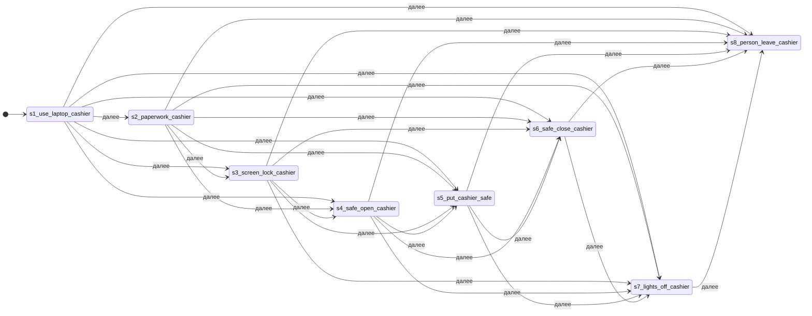

## Экземпляры процедуры (L2)

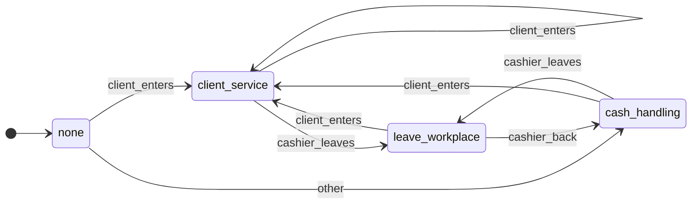

## Сцена: client (`client_present`)

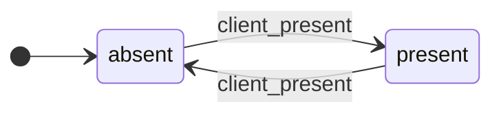

## Сцена: visitors (`visitors`)

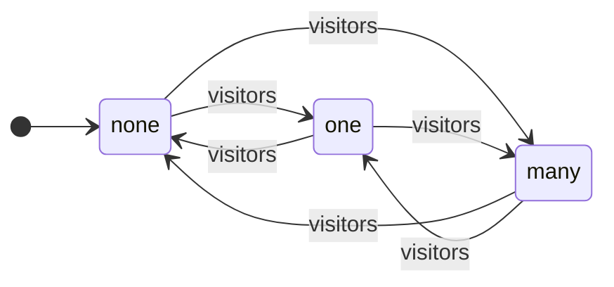

## Сцена: pair (`two_at_cashier`)

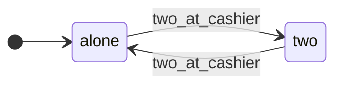

## Сцена: cashier (`cashier_present`)

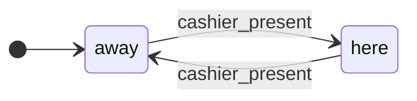

## Сцена: desk_money (`money_on_desk`)

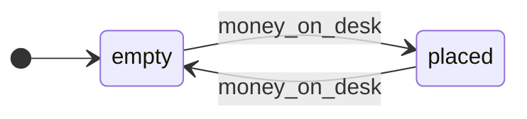

## Сцена: machine_money (`money_in_machine`)

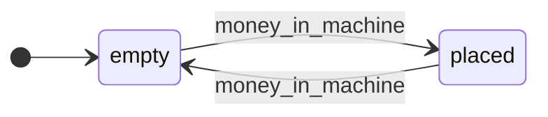

## Сцена: desk_foreign (`foreign_on_desk`)

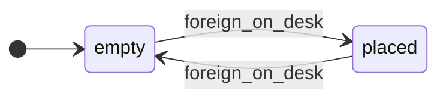

## Сцена: desk_bag (`bag_on_desk`)

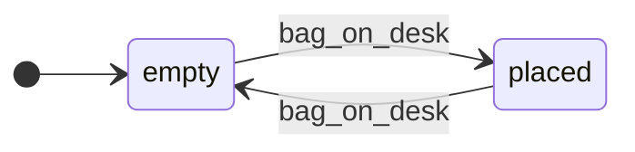

## Сцена: bundles (`bundles_at_cashier`)

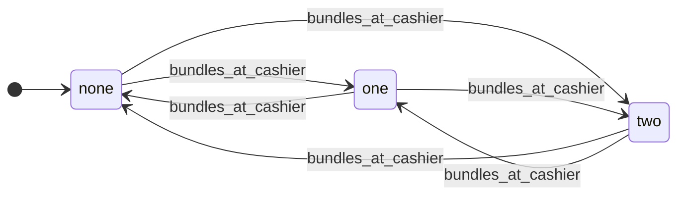

## Сцена: screen (`screen_on`)

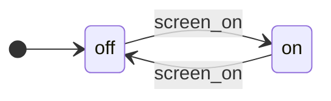

## Сцена: phone (`phone_at_head`)

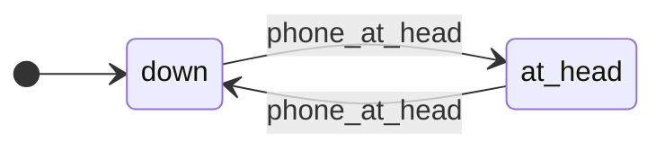
